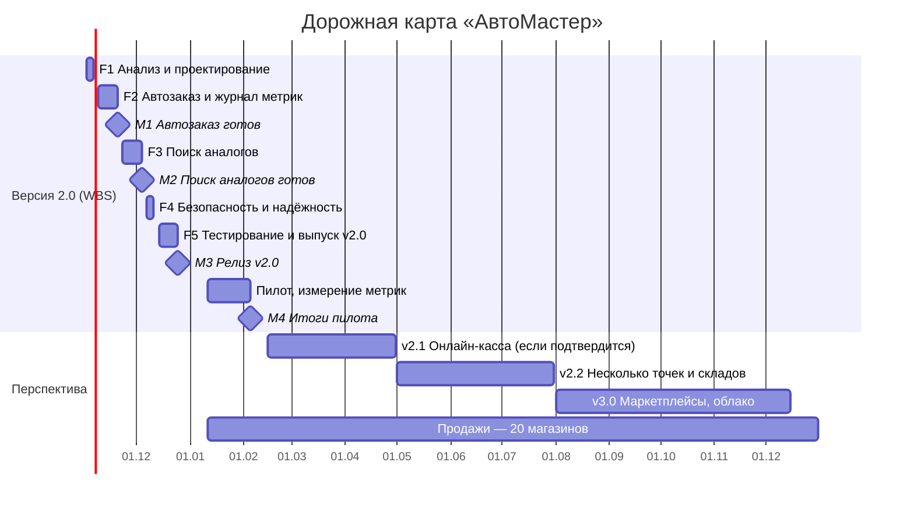

# АвтоМастер — учёт автозапчастей

**О проекте.** Локальное веб-приложение (PHP + MySQL) для учёта в небольшом магазине автозапчастей: каталог и склад, продажи с чеком, заказы, поставки и долги поставщикам, отчёты о прибыли. Работает на компьютере магазина без интернета.

**Цель.** Упростить учёт товара, закупки и продажи и помочь владельцу видеть прибыль и долги поставщикам.

**Управление работой.** Вместо Яндекс Трекера используется GitHub: задачи — Issues, планирование и дорожная карта — Projects. На этой странице по каждой лабораторной сначала приведено задание, под ним — выполнение.

**Содержание:** [ЛАБА 5 — WBS и дорожная карта](#лаба-5--иерархия-структуры-работ-и-дорожная-карта) · [Установка программы](#установка-на-openserver)

---

## ЛАБА 5 — Иерархия структуры работ и дорожная карта

### 📋 Задание

**Цель:** построить структуру разбиения работ (WBS) в системе управления проектами; научиться декомпозировать проект на иерархические элементы и организовывать задачи; разработать дорожную карту проекта.
**Результат:** иерархия структуры работ (WBS), дорожная карта.

Возьмите продукт из ЛР № 4 и для него:

1. Создайте проект в Яндекс Трекере с названием «[Фамилия/фамилии] — WBS — [Название проекта]».
2. Постройте WBS из не менее 4 фаз и 15 подзадач (минимум 2 уровня вложенности).
3. Используйте: подзадачи; метки; приоритеты; описания.
4. Экспортируйте структуру в PDF и приложите к отчёту.
5. По ИСР сделайте дорожную карту проекта, учитывая данные из лабораторной работы № 4. Дорожная карта должна отражать перспективу развития проекта.

**Форма отчёта:** скриншот иерархии задач; краткое описание принципов декомпозиции с обоснованием глубины WBS (почему выбрано такое количество уровней); дорожная карта проекта.

> Уровни WBS: проект → фазы → пакеты работ → задачи и подзадачи.
> Шаблон постановки задачи: ID, название, тип (эпик / фича / задача / подзадача), статус, приоритет; описание, требования, ограничения, ожидаемый результат; исполнитель, заказчик, сроки, трудоёмкость; критерии приёмки; ссылки, риски, зависимости.

### ✅ Выполнение

#### 1. Проект

Проект: **«[Фамилии] — WBS — АвтоМастер»** — развитие программы до версии 2.0 по итогам ЛР № 4. В ЛР № 4 подтверждены две гипотезы: автоформирование заказа поставщику и поиск аналогов по кросс-номерам; GAP-анализ показал, что в программе нет входа по паролю и автоматического резервного копирования. Интеграция с онлайн-кассой не подтвердилась и в версию 2.0 не входит.

Система управления — GitHub вместо Яндекс Трекера:

| Яндекс Трекер | GitHub |
|---|---|
| Проект | Project |
| Задача / эпик / подзадача | Issue + метка `type: epic / task / subtask` |
| Иерархия (дерево задач) | Sub-issues |
| Метки | Labels |
| Приоритет | Метки `priority: high / medium / low` |
| Исполнитель, сроки, трудоёмкость | Assignees, поля «Начало», «Окончание», «Трудоёмкость, ч» |
| Экспорт | Экспорт таблицы проекта в CSV |

#### 2. WBS — 5 фаз, 18 пакетов работ, 9 подзадач (3 уровня, 180 ч)


| Код | Элемент WBS | Тип | Приоритет | Сроки | Ч | Метки |
|---|---|---|---|---|---|---|
| F1 | **Анализ и проектирование** | Эпик | Высокий | 02.11–06.11 | 20 | `type: epic`, `analysis` |
| &nbsp;&nbsp;&nbsp;&nbsp;F1.1 | &nbsp;&nbsp;&nbsp;&nbsp;Требования и пользовательские сценарии | Задача | Высокий | 02.11–03.11 | 6 | `type: task`, `analysis` |
| &nbsp;&nbsp;&nbsp;&nbsp;F1.2 | &nbsp;&nbsp;&nbsp;&nbsp;Проектирование изменений базы данных | Задача | Высокий | 03.11–05.11 | 8 | `type: task`, `analysis`, `database` |
| &nbsp;&nbsp;&nbsp;&nbsp;&nbsp;&nbsp;&nbsp;&nbsp;F1.2.1 | &nbsp;&nbsp;&nbsp;&nbsp;&nbsp;&nbsp;&nbsp;&nbsp;Схема заказов поставщику (purchase_orders) | Подзадача | Высокий | 03.11–03.11 | 2 | `type: subtask`, `database`, `auto-order` |
| &nbsp;&nbsp;&nbsp;&nbsp;&nbsp;&nbsp;&nbsp;&nbsp;F1.2.2 | &nbsp;&nbsp;&nbsp;&nbsp;&nbsp;&nbsp;&nbsp;&nbsp;Схема кросс-номеров (part_crosses) | Подзадача | Высокий | 04.11–04.11 | 2 | `type: subtask`, `database`, `cross-search` |
| &nbsp;&nbsp;&nbsp;&nbsp;&nbsp;&nbsp;&nbsp;&nbsp;F1.2.3 | &nbsp;&nbsp;&nbsp;&nbsp;&nbsp;&nbsp;&nbsp;&nbsp;Схема журналов метрик (stock_log, demand_log) | Подзадача | Высокий | 04.11–04.11 | 2 | `type: subtask`, `database`, `analytics` |
| &nbsp;&nbsp;&nbsp;&nbsp;&nbsp;&nbsp;&nbsp;&nbsp;F1.2.4 | &nbsp;&nbsp;&nbsp;&nbsp;&nbsp;&nbsp;&nbsp;&nbsp;Схема пользователей и ролей (users) | Подзадача | Средний | 05.11–05.11 | 2 | `type: subtask`, `database`, `security` |
| &nbsp;&nbsp;&nbsp;&nbsp;F1.3 | &nbsp;&nbsp;&nbsp;&nbsp;Макеты экранов и критерии приёмки | Задача | Средний | 05.11–06.11 | 6 | `type: task`, `design`, `docs` |
| F2 | **Автозаказ поставщику и журнал метрик** | Эпик | Высокий | 09.11–20.11 | 46 | `type: epic`, `auto-order` |
| &nbsp;&nbsp;&nbsp;&nbsp;F2.1 | &nbsp;&nbsp;&nbsp;&nbsp;Журнал остатков и отказов покупателям | Задача | Высокий | 09.11–10.11 | 12 | `type: task`, `analytics`, `backend` |
| &nbsp;&nbsp;&nbsp;&nbsp;F2.2 | &nbsp;&nbsp;&nbsp;&nbsp;Расчёт рекомендуемого количества к заказу | Задача | Высокий | 11.11–12.11 | 8 | `type: task`, `auto-order`, `backend` |
| &nbsp;&nbsp;&nbsp;&nbsp;F2.3 | &nbsp;&nbsp;&nbsp;&nbsp;Экран «Сформировать заказ» | Задача | Высокий | 13.11–17.11 | 12 | `type: task`, `auto-order`, `frontend` |
| &nbsp;&nbsp;&nbsp;&nbsp;&nbsp;&nbsp;&nbsp;&nbsp;F2.3.1 | &nbsp;&nbsp;&nbsp;&nbsp;&nbsp;&nbsp;&nbsp;&nbsp;Таблица позиций с правкой количества | Подзадача | Высокий | 13.11–16.11 | 8 | `type: subtask`, `auto-order`, `frontend` |
| &nbsp;&nbsp;&nbsp;&nbsp;&nbsp;&nbsp;&nbsp;&nbsp;F2.3.2 | &nbsp;&nbsp;&nbsp;&nbsp;&nbsp;&nbsp;&nbsp;&nbsp;Печать и выгрузка заказа в Excel | Подзадача | Средний | 17.11–17.11 | 4 | `type: subtask`, `auto-order`, `frontend` |
| &nbsp;&nbsp;&nbsp;&nbsp;F2.4 | &nbsp;&nbsp;&nbsp;&nbsp;Приём заказа как поставки | Задача | Средний | 18.11–19.11 | 8 | `type: task`, `auto-order`, `backend` |
| &nbsp;&nbsp;&nbsp;&nbsp;F2.5 | &nbsp;&nbsp;&nbsp;&nbsp;Тестирование автозаказа | Задача | Высокий | 20.11–20.11 | 6 | `type: task`, `auto-order`, `qa` |
| F3 | **Поиск аналогов по кросс-номерам** | Эпик | Высокий | 23.11–04.12 | 40 | `type: epic`, `cross-search` |
| &nbsp;&nbsp;&nbsp;&nbsp;F3.1 | &nbsp;&nbsp;&nbsp;&nbsp;Нормализация номеров и поиск по группе | Задача | Высокий | 23.11–25.11 | 12 | `type: task`, `cross-search`, `backend` |
| &nbsp;&nbsp;&nbsp;&nbsp;F3.2 | &nbsp;&nbsp;&nbsp;&nbsp;Импорт кроссов из CSV поставщика | Задача | Средний | 26.11–27.11 | 8 | `type: task`, `cross-search`, `backend` |
| &nbsp;&nbsp;&nbsp;&nbsp;F3.3 | &nbsp;&nbsp;&nbsp;&nbsp;Блок «Аналоги в наличии» в каталоге и продаже | Задача | Высокий | 30.11–02.12 | 12 | `type: task`, `cross-search`, `frontend` |
| &nbsp;&nbsp;&nbsp;&nbsp;F3.4 | &nbsp;&nbsp;&nbsp;&nbsp;Тестирование поиска аналогов | Задача | Высокий | 03.12–04.12 | 8 | `type: task`, `cross-search`, `qa` |
| F4 | **Безопасность и надёжность** | Эпик | Средний | 07.12–11.12 | 30 | `type: epic`, `security` |
| &nbsp;&nbsp;&nbsp;&nbsp;F4.1 | &nbsp;&nbsp;&nbsp;&nbsp;Авторизация пользователей и роли | Задача | Средний | 07.12–10.12 | 20 | `type: task`, `security`, `backend` |
| &nbsp;&nbsp;&nbsp;&nbsp;&nbsp;&nbsp;&nbsp;&nbsp;F4.1.1 | &nbsp;&nbsp;&nbsp;&nbsp;&nbsp;&nbsp;&nbsp;&nbsp;Страница входа и сессии | Подзадача | Средний | 07.12–08.12 | 8 | `type: subtask`, `security`, `frontend` |
| &nbsp;&nbsp;&nbsp;&nbsp;&nbsp;&nbsp;&nbsp;&nbsp;F4.1.2 | &nbsp;&nbsp;&nbsp;&nbsp;&nbsp;&nbsp;&nbsp;&nbsp;Права ролей «владелец / продавец» | Подзадача | Средний | 09.12–09.12 | 6 | `type: subtask`, `security`, `backend` |
| &nbsp;&nbsp;&nbsp;&nbsp;&nbsp;&nbsp;&nbsp;&nbsp;F4.1.3 | &nbsp;&nbsp;&nbsp;&nbsp;&nbsp;&nbsp;&nbsp;&nbsp;Журнал действий пользователей | Подзадача | Низкий | 10.12–10.12 | 6 | `type: subtask`, `security`, `database` |
| &nbsp;&nbsp;&nbsp;&nbsp;F4.2 | &nbsp;&nbsp;&nbsp;&nbsp;Резервное копирование БД | Задача | Средний | 10.12–11.12 | 10 | `type: task`, `database`, `backend` |
| F5 | **Тестирование, документация и выпуск** | Эпик | Высокий | 14.12–05.02 | 44 | `type: epic`, `qa`, `docs` |
| &nbsp;&nbsp;&nbsp;&nbsp;F5.1 | &nbsp;&nbsp;&nbsp;&nbsp;Регрессионное тестирование версии 2.0 | Задача | Высокий | 14.12–17.12 | 16 | `type: task`, `qa` |
| &nbsp;&nbsp;&nbsp;&nbsp;F5.2 | &nbsp;&nbsp;&nbsp;&nbsp;README и инструкция пользователя | Задача | Средний | 18.12–21.12 | 8 | `type: task`, `docs` |
| &nbsp;&nbsp;&nbsp;&nbsp;F5.3 | &nbsp;&nbsp;&nbsp;&nbsp;Выпуск v2.0 и установка в пилотном магазине | Задача | Высокий | 22.12–25.12 | 8 | `type: task`, `docs` |
| &nbsp;&nbsp;&nbsp;&nbsp;F5.4 | &nbsp;&nbsp;&nbsp;&nbsp;Измерение метрик CastDev (#1, #2) | Задача | Средний | 11.01–05.02 | 12 | `type: task`, `analytics` |

Итого: 5 фаз (уровень 1), 18 пакетов работ (уровень 2), 9 подзадач (уровень 3) — **27 подзадач** при требуемых 15, **3 уровня** при требуемых 2.

#### 3. Подзадачи, метки, приоритеты, описания

- **Подзадачи** — иерархия фаза → пакет работ → подзадача; третий уровень у F1.2 (схема БД), F2.3 (экран заказа) и F4.1 (авторизация).
- **Метки:** тип — `type: epic / task / subtask`; направление — `analysis`, `backend`, `frontend`, `database`, `design`, `qa`, `docs`, `analytics`; функция — `auto-order` (автозаказ), `cross-search` (поиск аналогов), `security`.
- **Приоритеты:** Высокий — 19 элементов, Средний — 12, Низкий — 1 (`priority: high / medium / low`).
- **Описания** — каждая задача оформлена по шаблону. Пример:

| Поле | F2.2 Расчёт рекомендуемого количества к заказу |
|---|---|
| Тип / статус / приоритет | Задача (уровень 2) / Открыта / Высокий |
| Описание | Метод PartRepository::reorderSuggestions(): позиции с остатком ниже минимального, количество к заказу, поставщик и цена из последней поставки. |
| Требования | К заказу = max(2 × минимум − остаток; средние продажи в день за 30 дней × срок поставки) |
| Ограничения | Позиции без поставок показываются без поставщика |
| Ожидаемый результат | Список рекомендаций, сгруппированный по поставщикам |
| Исполнитель / заказчик | Разработчик (Студент 2) / владелец магазина «ИП Мелекесов» |
| Сроки, трудоёмкость | 11.11.2026 – 12.11.2026, 8 ч |
| Критерии приёмки | На демо-данных масло Mobil 5W-30 (остаток 0) и ролик INA (1 при минимуме 2) попадают в список |
| Зависимости | Зависит от F1.2.1 (схема заказов поставщику) |

#### 4. Экспорт

Таблица WBS выше — выгрузка структуры проекта; в отчёт она вставлена как приложение А, отчёт сохраняется в PDF.

#### 5. Принципы декомпозиции и глубина WBS

- **Сверху вниз:** проект → фазы → пакеты работ → подзадачи.
- **Правило 100 %:** в WBS вошли все работы версии 2.0 — анализ, база данных, две функции из ЛР № 4, безопасность, тестирование, документация, выпуск и измерение метрик; работ вне объёма (касса) нет.
- **Ориентация на результат:** элементы названы по проверяемому результату («Экран „Сформировать заказ“», «Импорт кроссов из CSV»).
- **Правило 8/80:** пакеты работ — от 6 до 20 часов, каждый можно оценить, назначить одному исполнителю и закрыть.
- **Группировка по функциям:** фазы F2 и F3 совпадают с гипотезами ЛР № 4, поэтому прогресс фазы = готовность улучшения.

**Почему 3 уровня.** Уровень 1 (фазы) показывает крупные этапы и совпадает со спринтами. Уровень 2 (пакеты работ) — основная единица планирования. Уровень 3 добавлен только там, где пакет состоит из независимо проверяемых частей (схема БД — 4 группы таблиц, экран заказа, авторизация). Дробить дальше, до отдельных коммитов, нецелесообразно: пакеты по 6–20 ч уже управляемы, а мелкие шаги удобнее вести чек-листом внутри задачи.

### 🗺️ Дорожная карта



| Период | Этап | Результат | Основание (ЛР № 4) |
|---|---|---|---|
| 02.11 – 06.11.2026 | F1 Анализ и проектирование | Сценарии, схема БД, макеты | — |
| 09.11 – 20.11.2026 | F2 Автозаказ и журнал метрик | Заказ поставщику формируется автоматически | Гипотеза 1 подтверждена (80 % / 80 %) |
| 23.11 – 04.12.2026 | F3 Поиск аналогов | Аналоги в наличии при поиске | Гипотеза 2 подтверждена (70 % / 70 %) |
| 07.12 – 11.12.2026 | F4 Безопасность | Вход по паролю, роли, резервные копии | GAP «Безопасность» |
| 14.12 – 25.12.2026 | F5 Тестирование и выпуск | Релиз v2.0 в магазине | — |
| 11.01 – 05.02.2027 | Пилот | Решение по гипотезам по метрикам | Этап «Измерение» CastDev |
| февраль – апрель 2027 | v2.1 | Онлайн-касса — только если повторная проверка подтвердит | Гипотеза 3 не подтверждена (40 %) |
| май – июль 2027 | v2.2 | Несколько торговых точек и складов | Сегмент «небольшие сети» |
| август – декабрь 2027 | v3.0 | Обмен с маркетплейсами, облачные копии | Перспективный сегмент |
| 2027 – 2029 | Продажи | 20 магазинов к концу 2027 г., 300 — через 3 года | GAP «Клиенты», SOM |


---

## Установка на OpenServer

1. Скопируйте папку проекта в `C:\OSPanel\domains\auto-parts-diplom`
   (в OpenServer 6 — в `C:\OSPanel\home\auto-parts-diplom`).
2. В настройках OpenServer → «Модули» выберите PHP 7.4 или новее и MySQL 8.0 (или MariaDB 10.4+). Перезапустите сервер.
3. Откройте phpMyAdmin → вкладка «Импорт» → выберите файл `database/schema.sql` → «Вперёд».
   Будет создана база `auto_parts_db` с демонстрационными данными.
4. Откройте в браузере `http://auto-parts-diplom` (или выберите сайт в меню OpenServer → «Мои сайты»).

Вход в систему не нужен — программа сразу открывается на главной.

Если база не подключается — проверьте `config.php` (в OpenServer 6 в `host` пишется имя модуля, например `MySQL-8.0`).

## Структура

```
config.php              настройки БД и магазина
app/
  bootstrap.php         инициализация: сессия, автозагрузка классов
  Database.php          подключение PDO, транзакции
  helpers.php           экранирование, проверка ввода, CSRF, единый обработчик API
  models/               вся работа с БД (по разделам)
api/                    AJAX-обработчики (возвращают JSON)
views/layout/           общий макет: меню, шапка, подвал
assets/css, assets/js   оформление и скрипты страниц
*.php (в корне)         страницы: главная, склад, продажа, заказы, поставки, поставщики, отчёты
export.php              выгрузка отчётов в CSV для Excel
database/schema.sql     схема БД + демо-данные
```

## Порядок работы

1. «Склад и каталог» — завести категории, в них подкатегории, затем запчасти (артикул, остаток, закупочная и продажная цена, наценка считается сама).
2. «Продажа» — подобрать запчасти в корзину, указать скидку и способ оплаты, оформить, распечатать чек. Остаток списывается автоматически.
3. «Заказы» — история продаж: просмотр, правка открытых заказов, отмена с возвратом товара на склад, повторная печать чека.
4. «Поставки» — приход товара от поставщика (остаток и цены обновляются), накладные, оплата, возвраты поставщику.
5. «Отчёты» — продажи, прибыль по категориям, остатки, печать ценников, выгрузка в Excel.

## Надёжность

- все запросы к БД параметризованы (защита от SQL-инъекций);
- весь вывод экранируется (защита от XSS);
- CSRF-токен на каждом изменяющем запросе;
- операции со складом выполняются в транзакциях с блокировкой строк — остаток не может уйти в минус.
