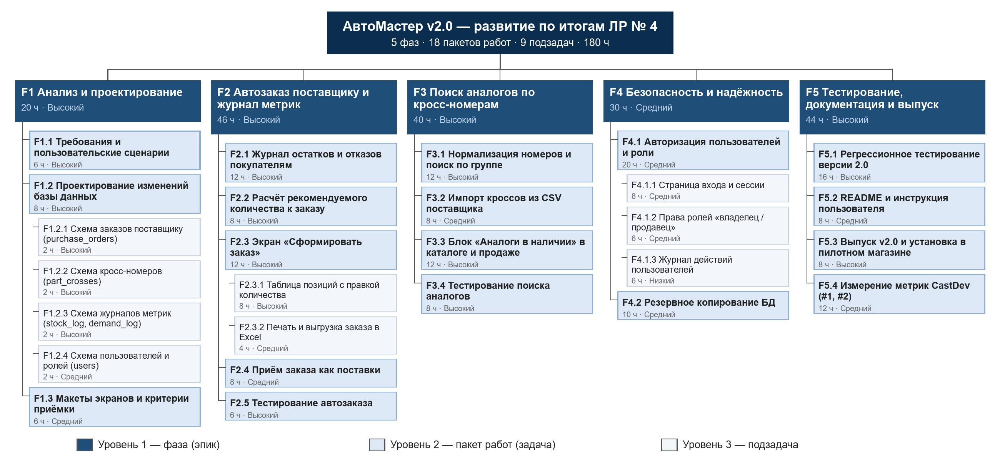
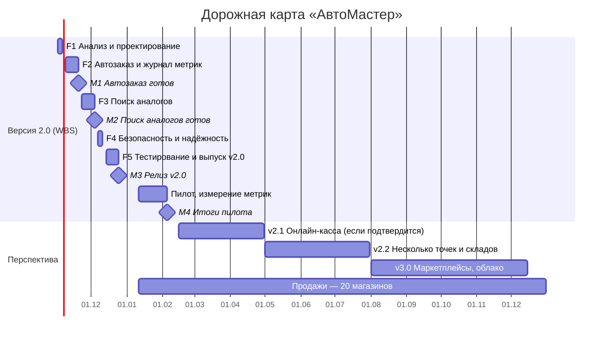
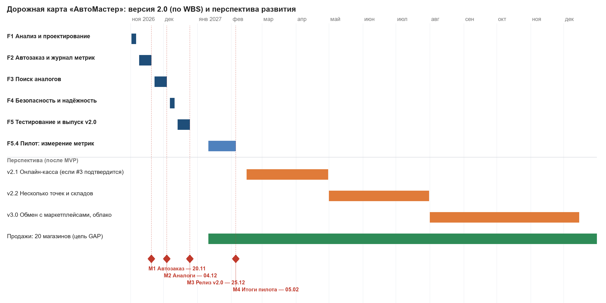
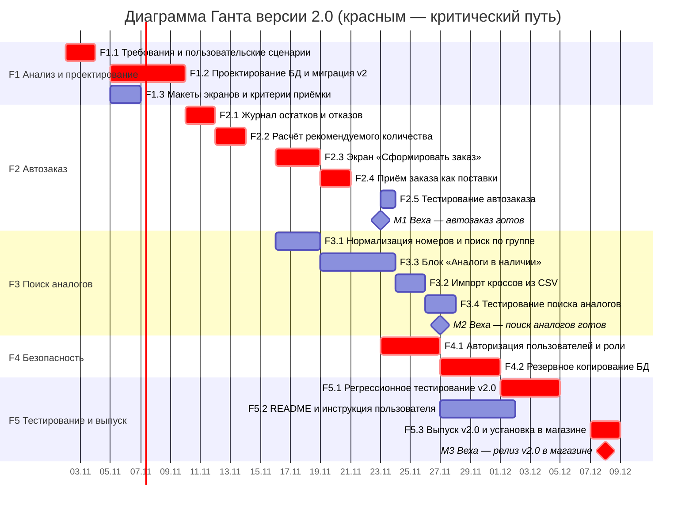
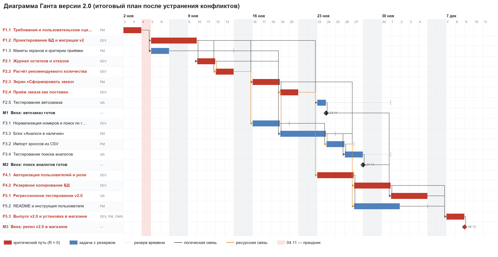
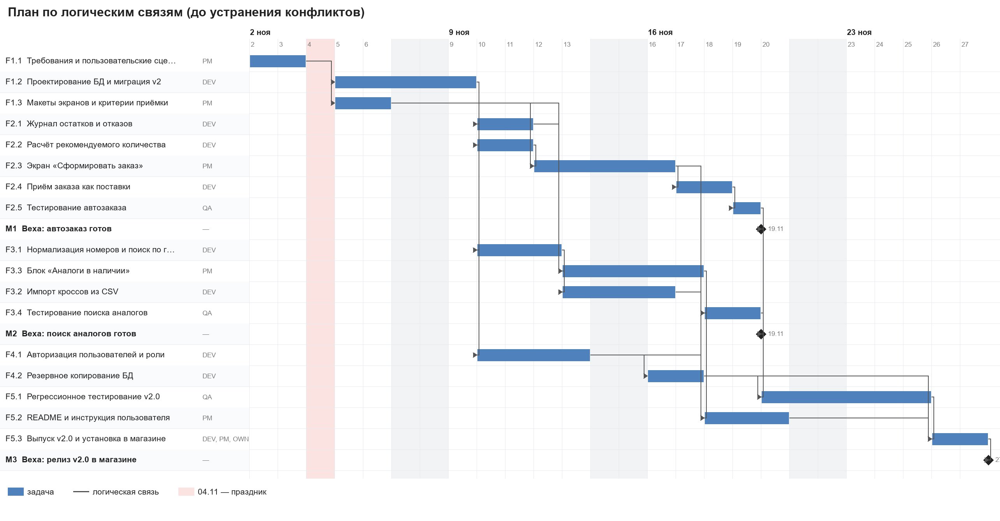
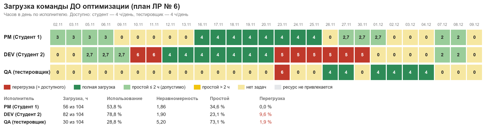
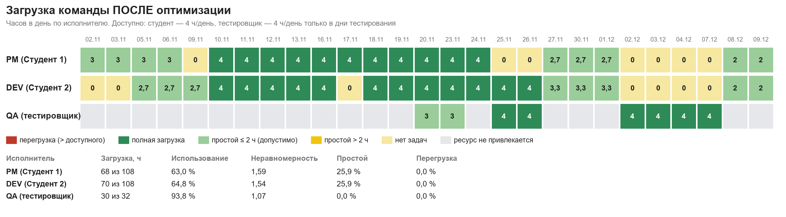
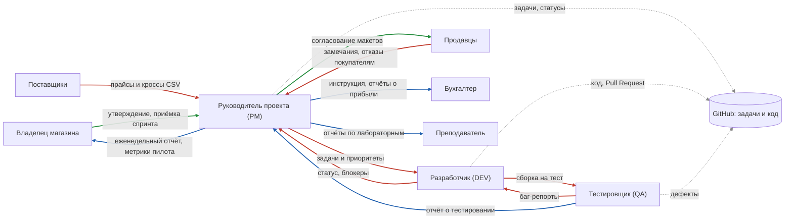
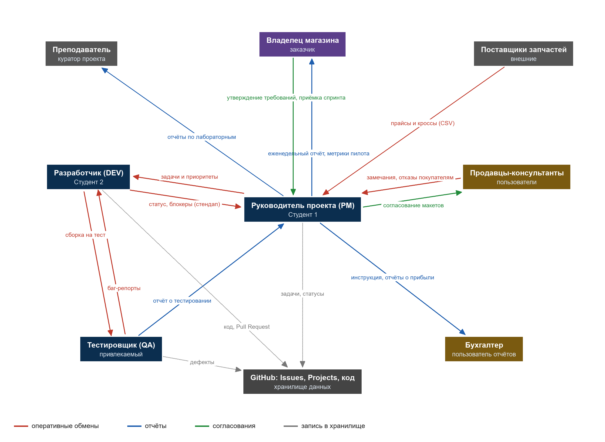

# АвтоМастер — учёт автозапчастей

**Выполнили:** Корчагин, Курочкин, Петрунов

**О проекте.** Локальное веб-приложение (PHP + MySQL) для учёта в небольшом магазине автозапчастей: каталог и склад, продажи с чеком, заказы, поставки и долги поставщикам, отчёты о прибыли. Работает на компьютере магазина без интернета.

**Цель.** Упростить учёт товара, закупки и продажи и помочь владельцу видеть прибыль и долги поставщикам.

**Управление работой.** Вместо Яндекс Трекера используется GitHub: задачи — Issues, планирование и дорожная карта — Projects. На этой странице по каждой лабораторной сначала приведено задание, под ним — выполнение.

**Содержание:** [ЛАБА 5 — WBS и дорожная карта](#лаба-5--иерархия-структуры-работ-и-дорожная-карта) · [ЛАБА 6 — Диаграмма Ганта](#лаба-6--календарное-планирование-и-диаграмма-ганта) · [ЛАБА 7 — Загрузка ресурсов](#лаба-7--анализ-и-оптимизация-загрузки-ресурсов) · [ЛАБА 8 — Коммуникации и RACI](#лаба-8--управление-коммуникациями-план-и-матрица-raci) · [Установка программы](#установка-на-openserver)

---

## ЛАБА 5 — Иерархия структуры работ и дорожная карта

### 📋 Задание

**Цель:** построить структуру разбиения работ (WBS) в системе управления проектами; научиться декомпозировать проект на иерархические элементы и организовывать задачи; разработать дорожную карту проекта.
**Результат:** иерархия структуры работ (WBS), дорожная карта.

Возьмите продукт из ЛР № 4 и для него:

1. Создайте проект в Яндекс Трекере с названием «[Фамилия/фамилии] — WBS — [Название проекта]».
2. Постройте WBS из не менее 4 фаз и 15 подзадач (минимум 2 уровня вложенности).
3. Используйте: подзадачи; метки; приоритеты; описания.
4. Экспортируйте структуру в PDF и приложите к отчёту.
5. По ИСР сделайте дорожную карту проекта, учитывая данные из лабораторной работы № 4. Дорожная карта должна отражать перспективу развития проекта.

**Форма отчёта:** скриншот иерархии задач; краткое описание принципов декомпозиции с обоснованием глубины WBS (почему выбрано такое количество уровней); дорожная карта проекта.

> Уровни WBS: проект → фазы → пакеты работ → задачи и подзадачи.
> Шаблон постановки задачи: ID, название, тип (эпик / фича / задача / подзадача), статус, приоритет; описание, требования, ограничения, ожидаемый результат; исполнитель, заказчик, сроки, трудоёмкость; критерии приёмки; ссылки, риски, зависимости.

### ✅ Выполнение

#### 1. Проект

Проект: **«Корчагин, Курочкин, Петрунов — WBS — АвтоМастер»** — развитие программы до версии 2.0 по итогам ЛР № 4. В ЛР № 4 подтверждены две гипотезы: автоформирование заказа поставщику и поиск аналогов по кросс-номерам; GAP-анализ показал, что в программе нет входа по паролю и автоматического резервного копирования. Интеграция с онлайн-кассой не подтвердилась и в версию 2.0 не входит.

Система управления — GitHub вместо Яндекс Трекера:

| Яндекс Трекер | GitHub |
|---|---|
| Проект | Project |
| Задача / эпик / подзадача | Issue + метка `type: epic / task / subtask` |
| Иерархия (дерево задач) | Sub-issues |
| Метки | Labels |
| Приоритет | Метки `priority: high / medium / low` |
| Исполнитель, сроки, трудоёмкость | Assignees, поля «Начало», «Окончание», «Трудоёмкость, ч» |
| Экспорт | Экспорт таблицы проекта в CSV |

#### 2. WBS — 5 фаз, 18 пакетов работ, 9 подзадач (3 уровня, 180 ч)



| Код | Элемент WBS | Тип | Приоритет | Сроки | Ч | Метки |
|---|---|---|---|---|---|---|
| F1 | **Анализ и проектирование** | Эпик | Высокий | 02.11–06.11 | 20 | `type: epic`, `analysis` |
| &nbsp;&nbsp;&nbsp;&nbsp;F1.1 | &nbsp;&nbsp;&nbsp;&nbsp;Требования и пользовательские сценарии | Задача | Высокий | 02.11–03.11 | 6 | `type: task`, `analysis` |
| &nbsp;&nbsp;&nbsp;&nbsp;F1.2 | &nbsp;&nbsp;&nbsp;&nbsp;Проектирование изменений базы данных | Задача | Высокий | 03.11–05.11 | 8 | `type: task`, `analysis`, `database` |
| &nbsp;&nbsp;&nbsp;&nbsp;&nbsp;&nbsp;&nbsp;&nbsp;F1.2.1 | &nbsp;&nbsp;&nbsp;&nbsp;&nbsp;&nbsp;&nbsp;&nbsp;Схема заказов поставщику (purchase_orders) | Подзадача | Высокий | 03.11–03.11 | 2 | `type: subtask`, `database`, `auto-order` |
| &nbsp;&nbsp;&nbsp;&nbsp;&nbsp;&nbsp;&nbsp;&nbsp;F1.2.2 | &nbsp;&nbsp;&nbsp;&nbsp;&nbsp;&nbsp;&nbsp;&nbsp;Схема кросс-номеров (part_crosses) | Подзадача | Высокий | 04.11–04.11 | 2 | `type: subtask`, `database`, `cross-search` |
| &nbsp;&nbsp;&nbsp;&nbsp;&nbsp;&nbsp;&nbsp;&nbsp;F1.2.3 | &nbsp;&nbsp;&nbsp;&nbsp;&nbsp;&nbsp;&nbsp;&nbsp;Схема журналов метрик (stock_log, demand_log) | Подзадача | Высокий | 04.11–04.11 | 2 | `type: subtask`, `database`, `analytics` |
| &nbsp;&nbsp;&nbsp;&nbsp;&nbsp;&nbsp;&nbsp;&nbsp;F1.2.4 | &nbsp;&nbsp;&nbsp;&nbsp;&nbsp;&nbsp;&nbsp;&nbsp;Схема пользователей и ролей (users) | Подзадача | Средний | 05.11–05.11 | 2 | `type: subtask`, `database`, `security` |
| &nbsp;&nbsp;&nbsp;&nbsp;F1.3 | &nbsp;&nbsp;&nbsp;&nbsp;Макеты экранов и критерии приёмки | Задача | Средний | 05.11–06.11 | 6 | `type: task`, `design`, `docs` |
| F2 | **Автозаказ поставщику и журнал метрик** | Эпик | Высокий | 09.11–20.11 | 46 | `type: epic`, `auto-order` |
| &nbsp;&nbsp;&nbsp;&nbsp;F2.1 | &nbsp;&nbsp;&nbsp;&nbsp;Журнал остатков и отказов покупателям | Задача | Высокий | 09.11–10.11 | 12 | `type: task`, `analytics`, `backend` |
| &nbsp;&nbsp;&nbsp;&nbsp;F2.2 | &nbsp;&nbsp;&nbsp;&nbsp;Расчёт рекомендуемого количества к заказу | Задача | Высокий | 11.11–12.11 | 8 | `type: task`, `auto-order`, `backend` |
| &nbsp;&nbsp;&nbsp;&nbsp;F2.3 | &nbsp;&nbsp;&nbsp;&nbsp;Экран «Сформировать заказ» | Задача | Высокий | 13.11–17.11 | 12 | `type: task`, `auto-order`, `frontend` |
| &nbsp;&nbsp;&nbsp;&nbsp;&nbsp;&nbsp;&nbsp;&nbsp;F2.3.1 | &nbsp;&nbsp;&nbsp;&nbsp;&nbsp;&nbsp;&nbsp;&nbsp;Таблица позиций с правкой количества | Подзадача | Высокий | 13.11–16.11 | 8 | `type: subtask`, `auto-order`, `frontend` |
| &nbsp;&nbsp;&nbsp;&nbsp;&nbsp;&nbsp;&nbsp;&nbsp;F2.3.2 | &nbsp;&nbsp;&nbsp;&nbsp;&nbsp;&nbsp;&nbsp;&nbsp;Печать и выгрузка заказа в Excel | Подзадача | Средний | 17.11–17.11 | 4 | `type: subtask`, `auto-order`, `frontend` |
| &nbsp;&nbsp;&nbsp;&nbsp;F2.4 | &nbsp;&nbsp;&nbsp;&nbsp;Приём заказа как поставки | Задача | Средний | 18.11–19.11 | 8 | `type: task`, `auto-order`, `backend` |
| &nbsp;&nbsp;&nbsp;&nbsp;F2.5 | &nbsp;&nbsp;&nbsp;&nbsp;Тестирование автозаказа | Задача | Высокий | 20.11–20.11 | 6 | `type: task`, `auto-order`, `qa` |
| F3 | **Поиск аналогов по кросс-номерам** | Эпик | Высокий | 23.11–04.12 | 40 | `type: epic`, `cross-search` |
| &nbsp;&nbsp;&nbsp;&nbsp;F3.1 | &nbsp;&nbsp;&nbsp;&nbsp;Нормализация номеров и поиск по группе | Задача | Высокий | 23.11–25.11 | 12 | `type: task`, `cross-search`, `backend` |
| &nbsp;&nbsp;&nbsp;&nbsp;F3.2 | &nbsp;&nbsp;&nbsp;&nbsp;Импорт кроссов из CSV поставщика | Задача | Средний | 26.11–27.11 | 8 | `type: task`, `cross-search`, `backend` |
| &nbsp;&nbsp;&nbsp;&nbsp;F3.3 | &nbsp;&nbsp;&nbsp;&nbsp;Блок «Аналоги в наличии» в каталоге и продаже | Задача | Высокий | 30.11–02.12 | 12 | `type: task`, `cross-search`, `frontend` |
| &nbsp;&nbsp;&nbsp;&nbsp;F3.4 | &nbsp;&nbsp;&nbsp;&nbsp;Тестирование поиска аналогов | Задача | Высокий | 03.12–04.12 | 8 | `type: task`, `cross-search`, `qa` |
| F4 | **Безопасность и надёжность** | Эпик | Средний | 07.12–11.12 | 30 | `type: epic`, `security` |
| &nbsp;&nbsp;&nbsp;&nbsp;F4.1 | &nbsp;&nbsp;&nbsp;&nbsp;Авторизация пользователей и роли | Задача | Средний | 07.12–10.12 | 20 | `type: task`, `security`, `backend` |
| &nbsp;&nbsp;&nbsp;&nbsp;&nbsp;&nbsp;&nbsp;&nbsp;F4.1.1 | &nbsp;&nbsp;&nbsp;&nbsp;&nbsp;&nbsp;&nbsp;&nbsp;Страница входа и сессии | Подзадача | Средний | 07.12–08.12 | 8 | `type: subtask`, `security`, `frontend` |
| &nbsp;&nbsp;&nbsp;&nbsp;&nbsp;&nbsp;&nbsp;&nbsp;F4.1.2 | &nbsp;&nbsp;&nbsp;&nbsp;&nbsp;&nbsp;&nbsp;&nbsp;Права ролей «владелец / продавец» | Подзадача | Средний | 09.12–09.12 | 6 | `type: subtask`, `security`, `backend` |
| &nbsp;&nbsp;&nbsp;&nbsp;&nbsp;&nbsp;&nbsp;&nbsp;F4.1.3 | &nbsp;&nbsp;&nbsp;&nbsp;&nbsp;&nbsp;&nbsp;&nbsp;Журнал действий пользователей | Подзадача | Низкий | 10.12–10.12 | 6 | `type: subtask`, `security`, `database` |
| &nbsp;&nbsp;&nbsp;&nbsp;F4.2 | &nbsp;&nbsp;&nbsp;&nbsp;Резервное копирование БД | Задача | Средний | 10.12–11.12 | 10 | `type: task`, `database`, `backend` |
| F5 | **Тестирование, документация и выпуск** | Эпик | Высокий | 14.12–05.02 | 44 | `type: epic`, `qa`, `docs` |
| &nbsp;&nbsp;&nbsp;&nbsp;F5.1 | &nbsp;&nbsp;&nbsp;&nbsp;Регрессионное тестирование версии 2.0 | Задача | Высокий | 14.12–17.12 | 16 | `type: task`, `qa` |
| &nbsp;&nbsp;&nbsp;&nbsp;F5.2 | &nbsp;&nbsp;&nbsp;&nbsp;README и инструкция пользователя | Задача | Средний | 18.12–21.12 | 8 | `type: task`, `docs` |
| &nbsp;&nbsp;&nbsp;&nbsp;F5.3 | &nbsp;&nbsp;&nbsp;&nbsp;Выпуск v2.0 и установка в пилотном магазине | Задача | Высокий | 22.12–25.12 | 8 | `type: task`, `docs` |
| &nbsp;&nbsp;&nbsp;&nbsp;F5.4 | &nbsp;&nbsp;&nbsp;&nbsp;Измерение метрик CastDev (#1, #2) | Задача | Средний | 11.01–05.02 | 12 | `type: task`, `analytics` |

Итого: 5 фаз (уровень 1), 18 пакетов работ (уровень 2), 9 подзадач (уровень 3) — **27 подзадач** при требуемых 15, **3 уровня** при требуемых 2.

#### 3. Подзадачи, метки, приоритеты, описания

- **Подзадачи** — иерархия фаза → пакет работ → подзадача; третий уровень у F1.2 (схема БД), F2.3 (экран заказа) и F4.1 (авторизация).
- **Метки:** тип — `type: epic / task / subtask`; направление — `analysis`, `backend`, `frontend`, `database`, `design`, `qa`, `docs`, `analytics`; функция — `auto-order` (автозаказ), `cross-search` (поиск аналогов), `security`.
- **Приоритеты:** Высокий — 19 элементов, Средний — 12, Низкий — 1 (`priority: high / medium / low`).
- **Описания** — каждая задача оформлена по шаблону. Пример:

| Поле | F2.2 Расчёт рекомендуемого количества к заказу |
|---|---|
| Тип / статус / приоритет | Задача (уровень 2) / Открыта / Высокий |
| Описание | Метод PartRepository::reorderSuggestions(): позиции с остатком ниже минимального, количество к заказу, поставщик и цена из последней поставки. |
| Требования | К заказу = max(2 × минимум − остаток; средние продажи в день за 30 дней × срок поставки) |
| Ограничения | Позиции без поставок показываются без поставщика |
| Ожидаемый результат | Список рекомендаций, сгруппированный по поставщикам |
| Исполнитель / заказчик | Разработчик (Студент 2) / владелец магазина «ИП Мелекесов» |
| Сроки, трудоёмкость | 11.11.2026 – 12.11.2026, 8 ч |
| Критерии приёмки | На демо-данных масло Mobil 5W-30 (остаток 0) и ролик INA (1 при минимуме 2) попадают в список |
| Зависимости | Зависит от F1.2.1 (схема заказов поставщику) |

#### 4. Экспорт

Таблица WBS выше — выгрузка структуры проекта; в отчёт она вставлена как приложение А, отчёт сохраняется в PDF.

#### 5. Принципы декомпозиции и глубина WBS

- **Сверху вниз:** проект → фазы → пакеты работ → подзадачи.
- **Правило 100 %:** в WBS вошли все работы версии 2.0 — анализ, база данных, две функции из ЛР № 4, безопасность, тестирование, документация, выпуск и измерение метрик; работ вне объёма (касса) нет.
- **Ориентация на результат:** элементы названы по проверяемому результату («Экран „Сформировать заказ“», «Импорт кроссов из CSV»).
- **Правило 8/80:** пакеты работ — от 6 до 20 часов, каждый можно оценить, назначить одному исполнителю и закрыть.
- **Группировка по функциям:** фазы F2 и F3 совпадают с гипотезами ЛР № 4, поэтому прогресс фазы = готовность улучшения.

**Почему 3 уровня.** Уровень 1 (фазы) показывает крупные этапы и совпадает со спринтами. Уровень 2 (пакеты работ) — основная единица планирования. Уровень 3 добавлен только там, где пакет состоит из независимо проверяемых частей (схема БД — 4 группы таблиц, экран заказа, авторизация). Дробить дальше, до отдельных коммитов, нецелесообразно: пакеты по 6–20 ч уже управляемы, а мелкие шаги удобнее вести чек-листом внутри задачи.

### 🗺️ Дорожная карта



| Период | Этап | Результат | Основание (ЛР № 4) |
|---|---|---|---|
| 02.11 – 06.11.2026 | F1 Анализ и проектирование | Сценарии, схема БД, макеты | — |
| 09.11 – 20.11.2026 | F2 Автозаказ и журнал метрик | Заказ поставщику формируется автоматически | Гипотеза 1 подтверждена (80 % / 80 %) |
| 23.11 – 04.12.2026 | F3 Поиск аналогов | Аналоги в наличии при поиске | Гипотеза 2 подтверждена (70 % / 70 %) |
| 07.12 – 11.12.2026 | F4 Безопасность | Вход по паролю, роли, резервные копии | GAP «Безопасность» |
| 14.12 – 25.12.2026 | F5 Тестирование и выпуск | Релиз v2.0 в магазине | — |
| 11.01 – 05.02.2027 | Пилот | Решение по гипотезам по метрикам | Этап «Измерение» CastDev |
| февраль – апрель 2027 | v2.1 | Онлайн-касса — только если повторная проверка подтвердит | Гипотеза 3 не подтверждена (40 %) |
| май – июль 2027 | v2.2 | Несколько торговых точек и складов | Сегмент «небольшие сети» |
| август – декабрь 2027 | v3.0 | Обмен с маркетплейсами, облачные копии | Перспективный сегмент |
| 2027 – 2029 | Продажи | 20 магазинов к концу 2027 г., 300 — через 3 года | GAP «Клиенты», SOM |



---

## ЛАБА 6 — Календарное планирование и диаграмма Ганта

### 📋 Задание

**Цель:** освоить навыки построения календарного плана проекта и работы с диаграммой Ганта в системе управления проектами.
**Результат:** диаграмма Ганта.

Воспользуйтесь результатами ЛР № 5:

1. Создайте календарный план для проекта.
2. Установите длительности для всех задач (минимум 15 задач).
3. Определите зависимости между задачами.
4. Постройте диаграмму Ганта.
5. Проанализируйте полученный план.
6. Найдите критический путь.
7. Выявите возможные конфликты.

**Форма отчёта:** скриншот диаграммы Ганта; таблица с основными параметрами задач (название, длительность, дата начала, дата окончания, приоритет, ресурсы); анализ критического пути; выявленные конфликты и их решения.

> Критический путь — самая длинная цепочка зависимых задач; задачи на нём не имеют резерва времени, и любая их задержка сдвигает срок проекта. Резерв R = позднее начало − раннее начало.

### ✅ Выполнение

#### 1. Календарный план

- Основа — WBS из ЛАБЫ 5: 18 пакетов работ и 4 вехи.
- Старт — 02.11.2026; рабочие дни пн–пт по 8 ч; **04.11.2026 — праздник**, новогодние каникулы 31.12.2026 – 10.01.2027.
- Связи «окончание — начало»: следующая задача начинается на следующий рабочий день после предшественника.

| Роль | Исполнитель | Функции |
|---|---|---|
| PM | Студент 1 | Руководитель проекта, аналитик, frontend, документация |
| DEV | Студент 2 | Backend, база данных, выпуск |
| QA | Тестировщик (привлекаемый) | Тестирование |
| OWN | Владелец магазина «ИП Мелекесов» | Заказчик: согласование, установка, пилот |

#### 2. Параметры задач — 18 задач и 4 вехи (минимум 15)

| ID | Задача | Длит., раб. дн. | Начало | Окончание | Приоритет | Ресурсы | Труд., ч |
|---|---|---|---|---|---|---|---|
| F1.1 | Требования и пользовательские сценарии | 2 | 02.11.2026 | 03.11.2026 | Высокий | PM | 6 |
| F1.2 | Проектирование БД и миграция v2 | 3 | 05.11.2026 | 09.11.2026 | Высокий | DEV | 8 |
| F1.3 | Макеты экранов и критерии приёмки | 2 | 05.11.2026 | 06.11.2026 | Средний | PM | 6 |
| F2.1 | Журнал остатков и отказов | 2 | 10.11.2026 | 11.11.2026 | Высокий | DEV | 12 |
| F2.2 | Расчёт рекомендуемого количества | 2 | 12.11.2026 | 13.11.2026 | Высокий | DEV | 8 |
| F2.3 | Экран «Сформировать заказ» | 3 | 16.11.2026 | 18.11.2026 | Высокий | PM | 12 |
| F2.4 | Приём заказа как поставки | 2 | 19.11.2026 | 20.11.2026 | Средний | DEV | 8 |
| F2.5 | Тестирование автозаказа | 1 | 23.11.2026 | 23.11.2026 | Высокий | QA | 6 |
| M1 | Веха: автозаказ готов | 0 | 23.11.2026 | 23.11.2026 | — | — | — |
| F3.1 | Нормализация номеров и поиск по группе | 3 | 16.11.2026 | 18.11.2026 | Высокий | DEV | 12 |
| F3.3 | Блок «Аналоги в наличии» | 3 | 19.11.2026 | 23.11.2026 | Высокий | PM | 12 |
| F3.2 | Импорт кроссов из CSV | 2 | 24.11.2026 | 25.11.2026 | Средний | PM | 8 |
| F3.4 | Тестирование поиска аналогов | 2 | 26.11.2026 | 27.11.2026 | Высокий | QA | 8 |
| M2 | Веха: поиск аналогов готов | 0 | 27.11.2026 | 27.11.2026 | — | — | — |
| F4.1 | Авторизация пользователей и роли | 4 | 23.11.2026 | 26.11.2026 | Средний | DEV | 20 |
| F4.2 | Резервное копирование БД | 2 | 27.11.2026 | 30.11.2026 | Средний | DEV | 10 |
| F5.1 | Регрессионное тестирование v2.0 | 4 | 01.12.2026 | 04.12.2026 | Высокий | QA | 16 |
| F5.2 | README и инструкция пользователя | 3 | 27.11.2026 | 01.12.2026 | Средний | PM | 8 |
| F5.3 | Выпуск v2.0 и установка в магазине | 2 | 07.12.2026 | 08.12.2026 | Высокий | DEV, PM, OWN | 8 |
| M3 | Веха: релиз v2.0 в магазине | 0 | 08.12.2026 | 08.12.2026 | — | — | — |
| F5.4 | Пилот: измерение метрик CastDev | 20 | 11.01.2027 | 05.02.2027 | Средний | PM, OWN | 12 |
| M4 | Веха: итоги пилота | 0 | 05.02.2027 | 05.02.2027 | — | — | — |

#### 3. Зависимости

| Предшественники | Последователь | Вид | Обоснование |
|---|---|---|---|
| F1.1 | F1.2, F1.3 | логическая | Схема БД и макеты строятся по утверждённым сценариям |
| F1.2 | F2.1, F3.1, F4.1 | логическая | Новые таблицы создаёт миграция v2 |
| F2.2, F1.3 | F2.3 | логическая | Экран заказа выводит рекомендации по макету |
| F2.3 | F2.4 → F2.5 → M1 | логическая | Приём заказа и тестирование — после экрана |
| F3.1, F2.1, F1.3 | F3.3 | логическая | Блок аналогов использует поиск и пишет отказы в журнал |
| F3.1 | F3.2 | логическая | Импорт сохраняет номера в нормализованном виде |
| F3.2, F3.3 | F3.4 → M2 | логическая | Тестируется весь сценарий поиска аналогов |
| F4.1 | F4.2 | логическая | Резервные копии доступны только владельцу |
| M1, M2, F4.2 | F5.1 | логическая | Регрессия — на собранной версии 2.0 |
| F5.1, F5.2, F4.2 | F5.3 → M3 | логическая | Выпуск — только после тестов и резервной копии |
| F2.1 → F2.2 → F3.1 → F2.4 → F4.1 → F4.2 | — | ресурсная (DEV) | Один backend-разработчик выполняет задачи по очереди |
| F3.3 → F3.2 → F5.2 | — | ресурсная (PM) | Очередь задач PM после делегирования F3.2 |

#### 4. Диаграмма Ганта



Расчётная диаграмма со связями (красным — критический путь, пунктир — резерв, оранжевые стрелки — ресурсные связи):



Пилот (F5.4, 20 раб. дн.) идёт после каникул: 11.01 – 05.02.2027, веха M4 «Итоги пилота».

#### 5. Анализ плана и критический путь

Ранние сроки — прямой проход от 02.11.2026, поздние — обратный проход от вехи M3. Резерв R = позднее начало − раннее начало (раб. дн.).

| Задача | Раннее начало | Раннее окончание | Позднее начало | Позднее окончание | Резерв R |
|---|---|---|---|---|---|
| F1.1 Требования и пользовательские сценарии | 02.11 | 03.11 | 02.11 | 03.11 | **0** |
| F1.2 Проектирование БД и миграция v2 | 05.11 | 09.11 | 05.11 | 09.11 | **0** |
| F1.3 Макеты экранов и критерии приёмки | 05.11 | 06.11 | 12.11 | 13.11 | 5 |
| F2.1 Журнал остатков и отказов | 10.11 | 11.11 | 10.11 | 11.11 | **0** |
| F2.2 Расчёт рекомендуемого количества | 12.11 | 13.11 | 12.11 | 13.11 | **0** |
| F2.3 Экран «Сформировать заказ» | 16.11 | 18.11 | 16.11 | 18.11 | **0** |
| F2.4 Приём заказа как поставки | 19.11 | 20.11 | 19.11 | 20.11 | **0** |
| F2.5 Тестирование автозаказа | 23.11 | 23.11 | 30.11 | 30.11 | 5 |
| F3.1 Нормализация номеров и поиск по группе | 16.11 | 18.11 | 17.11 | 19.11 | 1 |
| F3.3 Блок «Аналоги в наличии» | 19.11 | 23.11 | 20.11 | 24.11 | 1 |
| F3.2 Импорт кроссов из CSV | 24.11 | 25.11 | 25.11 | 26.11 | 1 |
| F3.4 Тестирование поиска аналогов | 26.11 | 27.11 | 27.11 | 30.11 | 1 |
| F4.1 Авторизация пользователей и роли | 23.11 | 26.11 | 23.11 | 26.11 | **0** |
| F4.2 Резервное копирование БД | 27.11 | 30.11 | 27.11 | 30.11 | **0** |
| F5.1 Регрессионное тестирование v2.0 | 01.12 | 04.12 | 01.12 | 04.12 | **0** |
| F5.2 README и инструкция пользователя | 27.11 | 01.12 | 02.12 | 04.12 | 3 |
| F5.3 Выпуск v2.0 и установка в магазине | 07.12 | 08.12 | 07.12 | 08.12 | **0** |

**Критический путь (R = 0):** F1.1 → F1.2 → F2.1 → F2.2 → F2.3 → F2.4 → F4.1 → F4.2 → F5.1 → F5.3 → M3 «Релиз v2.0» 08.12.2026 — **26 рабочих дней**.

- Путь проходит через все задачи backend-разработчика, экран заказа, регрессию и выпуск. Почти критична ветка поиска аналогов F3.1–F3.4 (резерв 1 день).
- Без ресурсных ограничений (только логические связи) релиз возможен 27.11 — через 19 дней. Разница 7 дней — из-за того, что backend-разработчик один: срок проекта определяет его загрузка.
- До контрольного срока 25.12.2026 из дорожной карты остаётся **буфер 13 рабочих дней**.

#### 6. Конфликты и решения

| № | Тип | Конфликт | Решение |
|---|---|---|---|
| 1 | Календарный | 04.11 — праздник, а в ЛАБЕ 5 на него стояли подзадачи схемы БД | Праздник исключён из календаря; F1.2 — 05.11–09.11 |
| 2 | Ресурсный | DEV 10–11.11 одновременно ведёт F2.1, F2.2, F3.1, F4.1 — 19 ч в день | Очередь задач DEV по приоритету (ресурсные связи) |
| 3 | Ресурсный | DEV — узкое место: все его задачи на критическом пути | Импорт кроссов F3.2 делегирован PM |
| 4 | Ресурсный | QA 19.11 — 10 ч; PM 13–16.11 — 8 ч без времени на управление | Задачи разнесены по датам |
| 5 | Логический | Для проверки гипотезы автозаказа нужен базовый уровень метрик ≥ 4 недель | Журнал метрик F2.1 — первым (готов 11.11) |
| 6 | Логический | Выпуск мог начаться до резервной копии | Жёсткая связь F4.2 → F5.3 |
| 7 | Календарный | Пилот пересекает новогодние каникулы | Пилот «не раньше 11.01.2027» |
| 8 | Плановый | Даты ЛАБЫ 5 не учитывали параллельность и связи (F4 стояла на 07–11.12) | Даты пересчитаны (таблица ниже) |

План до устранения конфликтов (видны четыре параллельные задачи DEV 10.11):



| Фаза | ЛАБА 5 | Расчёт ЛАБЫ 6 | Веха |
|---|---|---|---|
| F1 Анализ и проектирование | 02.11 – 06.11 | 02.11 – 09.11 | — |
| F2 Автозаказ и журнал метрик | 09.11 – 20.11 | 10.11 – 23.11 | M1 — 23.11 |
| F3 Поиск аналогов | 23.11 – 04.12 | 16.11 – 27.11 | M2 — 27.11 |
| F4 Безопасность | 07.12 – 11.12 | 23.11 – 30.11 | — |
| F5 Тестирование и выпуск | 14.12 – 25.12 | 27.11 – 08.12 | M3 — 08.12 |
| Пилот | 11.01 – 05.02.2027 | 11.01 – 05.02.2027 | M4 — 05.02 |

---

## ЛАБА 7 — Анализ и оптимизация загрузки ресурсов

### 📋 Задание

**Цель:** научиться выявлять перегрузку исполнителей, анализировать распределение задач и проводить балансировку нагрузки в проекте.
**Результат:** дашборд «Загрузка команды», расчёт показателей эффективности.

Воспользуйтесь результатами ЛР № 5, 6:

1. Создайте проект «Фамилия — Загрузка — Название проекта».
2. Используйте результаты предыдущих работ или добавьте не менее 12 задач с исполнителями, оценкой трудозатрат (в часах) и сроками выполнения.
3. Проанализируйте загрузку команды через дашборд.
4. Найдите не менее 3 проблем (перегрузка, простои).
5. Внесите 3 корректировки (перенос, переназначение, делегирование).
6. Сделайте скриншот до и после оптимизации.
7. Рассчитайте показатели эффективности.

**Форма отчёта:** скриншоты дашбордов; расчёт показателей эффективности; описание проблем и решений; выводы — как изменилась эффективность.

> Показатели: **использование** = фактическое время / доступное × 100 % (оптимально 60–85 %); **неравномерность** = максимальная дневная загрузка / средняя (≤ 1,5 — приемлемо); **простой** = часы простоя / доступное время × 100 %; **перегрузка** = часы сверх нормы / доступное время × 100 % (> 20 % — риск выгорания).

### ✅ Выполнение

#### 1. Проект и задачи

Проект **«Корчагин, Курочкин, Петрунов — Загрузка — АвтоМастер»** — 17 задач календарного плана ЛАБЫ 6 (минимум 12) с исполнителем, трудоёмкостью и сроками.

Доступное время: участники — студенты, совмещают проект с учёбой, поэтому **4 ч в рабочий день** (20 ч в неделю); тестировщик привлекается по договору. Перегрузка — работа сверх доступного времени, допустимый простой — до 2 ч в день. Период — от 02.11.2026 до релиза.

| ID | Задача | Исполнитель | Труд., ч | Сроки | Ч/день |
|---|---|---|---|---|---|
| F1.1 | Требования и пользовательские сценарии | PM | 6 | 02.11 – 03.11 | 3,0 |
| F1.2 | Проектирование БД и миграция v2 | DEV | 8 | 05.11 – 09.11 | 2,7 |
| F1.3 | Макеты экранов и критерии приёмки | PM | 6 | 05.11 – 06.11 | 3,0 |
| F2.1 | Журнал остатков и отказов | DEV | 12 | 10.11 – 11.11 | 6,0 |
| F2.2 | Расчёт рекомендуемого количества | DEV | 8 | 12.11 – 13.11 | 4,0 |
| F2.3 | Экран «Сформировать заказ» | PM | 12 | 16.11 – 18.11 | 4,0 |
| F2.4 | Приём заказа как поставки | DEV | 8 | 19.11 – 20.11 | 4,0 |
| F2.5 | Тестирование автозаказа | QA | 6 | 23.11 – 23.11 | 6,0 |
| F3.1 | Нормализация номеров и поиск по группе | DEV | 12 | 16.11 – 18.11 | 4,0 |
| F3.3 | Блок «Аналоги в наличии» | PM | 12 | 19.11 – 23.11 | 4,0 |
| F3.2 | Импорт кроссов из CSV | PM | 8 | 24.11 – 25.11 | 4,0 |
| F3.4 | Тестирование поиска аналогов | QA | 8 | 26.11 – 27.11 | 4,0 |
| F4.1 | Авторизация пользователей и роли | DEV | 20 | 23.11 – 26.11 | 5,0 |
| F4.2 | Резервное копирование БД | DEV | 10 | 27.11 – 30.11 | 5,0 |
| F5.1 | Регрессионное тестирование v2.0 | QA | 16 | 01.12 – 04.12 | 4,0 |
| F5.2 | README и инструкция пользователя | PM | 8 | 27.11 – 01.12 | 2,7 |
| F5.3 | Выпуск v2.0 и установка в магазине | DEV + PM | 8 | 07.12 – 08.12 | 4,0 |

#### 2. Дашборд «Загрузка команды» — ДО оптимизации



#### 3. Найденные проблемы — 5 (минимум 3)

| № | Тип | Проблема | Причина |
|---|---|---|---|
| 1 | Перегрузка | DEV 10–11.11: 6 ч в день при доступных 4 (150 %) | Журнал метрик F2.1 (12 ч) уложен в 2 дня |
| 2 | Перегрузка | DEV 23–30.11: 5 ч в день шесть дней подряд (125 %) | Авторизация F4.1 (20 ч за 4 дня) и резервное копирование F4.2 (10 ч за 2 дня) |
| 3 | Перегрузка | QA 23.11: 6 ч в день (150 %) | Тестирование автозаказа F2.5 (6 ч) за 1 день |
| 4 | Простой | PM 09–13.11: 5 рабочих дней без задач, пока DEV перегружен | Все задачи этих дней назначены на DEV |
| 5 | Простой | QA без задач 19 из 26 дней (73 %) | Тестировщик закреплён за проектом на весь период |

За весь период нагрузка тоже неравномерна: у DEV 82 ч, у PM 56 ч при одинаковом доступном времени.

#### 4. Корректировки — 5 (минимум 3)

| № | Метод | Что изменено | Решает |
|---|---|---|---|
| К1 | Переназначение | F2.1 «Журнал остатков и отказов» передан от DEV к PM: 3 дня по 4 ч | Проблемы 1 и 4 |
| К2 | Перенос (выравнивание сроков) | F4.1 «Авторизация» — 5 дней по 4 ч вместо 4 по 5 ч | Проблема 2 |
| К3 | Сглаживание | F2.5 «Тестирование автозаказа» — 2 дня по 3 ч вместо 1 дня по 6 ч | Проблема 3 |
| К4 | Перенос (выравнивание сроков) | F4.2 «Резервное копирование» — 3 дня по 3,3 ч вместо 2 по 5 ч | Проблема 2 |
| К5 | Изменение привлечения ресурса | Тестировщик привлекается только на дни тестирования (8 дней вместо 26) | Проблема 5 |

Изменённые задачи:

| ID | Задача | Исполнитель | Сроки до | Сроки после | Ч/день |
|---|---|---|---|---|---|
| F2.1 | Журнал остатков и отказов | DEV → **PM** | 10.11 – 11.11 | 10.11 – 12.11 | 6,0 → 4,0 |
| F2.2 | Расчёт рекомендуемого количества | DEV | 12.11 – 13.11 | 10.11 – 11.11 | 4,0 → 4,0 |
| F2.3 | Экран «Сформировать заказ» | PM | 16.11 – 18.11 | 13.11 – 17.11 | 4,0 → 4,0 |
| F2.4 | Приём заказа как поставки | DEV | 19.11 – 20.11 | 18.11 – 19.11 | 4,0 → 4,0 |
| F2.5 | Тестирование автозаказа | QA | 23.11 – 23.11 | 20.11 – 23.11 | 6,0 → 3,0 |
| F3.1 | Нормализация номеров и поиск по группе | DEV | 16.11 – 18.11 | 12.11 – 16.11 | 4,0 → 4,0 |
| F3.3 | Блок «Аналоги в наличии» | PM | 19.11 – 23.11 | 18.11 – 20.11 | 4,0 → 4,0 |
| F3.2 | Импорт кроссов из CSV | PM | 24.11 – 25.11 | 23.11 – 24.11 | 4,0 → 4,0 |
| F3.4 | Тестирование поиска аналогов | QA | 26.11 – 27.11 | 25.11 – 26.11 | 4,0 → 4,0 |
| F4.1 | Авторизация пользователей и роли | DEV | 23.11 – 26.11 | 20.11 – 26.11 | 5,0 → 4,0 |
| F4.2 | Резервное копирование БД | DEV | 27.11 – 30.11 | 27.11 – 01.12 | 5,0 → 3,3 |
| F5.1 | Регрессионное тестирование v2.0 | QA | 01.12 – 04.12 | 02.12 – 07.12 | 4,0 → 4,0 |
| F5.3 | Выпуск v2.0 и установка в магазине | DEV + PM | 07.12 – 08.12 | 08.12 – 09.12 | 4,0 → 4,0 |

Релиз сдвигается с 08.12 на **09.12.2026** (+1 рабочий день); буфер до контрольного срока 25.12 — 12 дней, срок проекта соблюдается.

#### 5. Дашборд «Загрузка команды» — ПОСЛЕ оптимизации



#### 6. Показатели эффективности (до → **после**)

| Показатель | PM | DEV | QA |
|---|---|---|---|
| Доступное время, ч | 104 → **108** | 104 → **108** | 104 → **32** |
| Фактическая загрузка, ч | 56,0 → **68,0** | 82,0 → **70,0** | 30,0 → **30,0** |
| Использование, % | 53,8 → **63,0** | 78,8 → **64,8** | 28,8 → **93,8** |
| Средняя загрузка, ч/день | 2,15 → **2,52** | 3,15 → **2,59** | 1,15 → **3,75** |
| Максимум за день, ч | 4,0 → **4,0** | 6,0 → **4,0** | 6,0 → **4,0** |
| Неравномерность | 1,86 → **1,59** | 1,90 → **1,54** | 5,20 → **1,07** |
| Простой, % | 34,6 → **25,9** | 23,1 → **25,9** | 73,1 → **0,0** |
| Перегрузка, % | 0,0 → **0,0** | 9,6 → **0,0** | 1,9 → **0,0** |

Пример расчёта для DEV до оптимизации: Доступно 26 дней × 4 ч = 104 ч, отработано 82 ч → использование 82 / 104 × 100 % = **78,8 %**; максимум 6 ч, среднее 82 / 26 = 3,15 ч → неравномерность **1,90**; сверх нормы 10 ч → перегрузка **9,6 %**; простой 24 ч → **23,1 %**.

#### 7. Выводы — как изменилась эффективность

- **Перегрузки устранены полностью:** DEV 9,6 % → 0 %, QA 1,9 % → 0 %; ни в один день никто не работает больше доступного времени.
- **Использование команды** выросло с 53,8 % до **67,7 %** — из «низкой загрузки» в оптимальный диапазон 60–85 %.
- **Неравномерность** снизилась у всех: PM 1,86 → 1,59, DEV 1,90 → 1,54, QA 5,20 → 1,07.
- **Нагрузка PM и DEV выровнялась:** 68 и 70 ч вместо 56 и 82 ч.
- **Простой** PM снизился с 34,6 до 25,9 %, QA — с 73,1 % до 0; у DEV немного вырос (23,1 → 25,9 %) — это плата за снятие перегрузки, а свободное время во время регрессии уходит на исправление дефектов.
- Цена оптимизации — релиз на 1 день позже, в пределах буфера.

---

## ЛАБА 8 — Управление коммуникациями: план и матрица RACI

### 📋 Задание

**Цель:** разработать комплексный план коммуникаций для программного проекта, включая коммуникационную матрицу (RACI) и схему информационных потоков; освоить инструменты визуализации и регламентации коммуникационных процессов в IT-проекте.
**Результат:** план коммуникаций (таблица); RACI-матрица ответственности; схема информационных потоков между участниками; шаблон отчёта по коммуникациям.

Воспользуйтесь результатами ЛР № 5:

1. Составьте список стейкхолдеров — 6–8 ключевых участников.
2. Разработайте план коммуникаций в табличном виде — минимум 6 строк.
3. Постройте RACI-матрицу: по строкам — задачи проекта (из WBS), по столбцам — стейкхолдеры; проставьте роли R/A/C/I. В матрице не должно быть задач без A, должен соблюдаться баланс R/C/I. Минимум 8 задач.
4. Создайте схему информационных потоков (DFD, канбан-доска или ментальная карта). Для ментальной карты: участники — узлы, стрелки показывают направление информации (подписать тип сообщения), цвета: оперативные обмены — красный, отчёты — синий, согласования — зелёный.
5. Разработайте шаблон отчёта по коммуникациям и заполните его: дата; участники встречи; принятые решения; открытые вопросы; следующие шаги; подписи.

**Форма отчёта:** список стейкхолдеров; план коммуникаций; RACI-матрица; схема информационных потоков; шаблон отчёта по коммуникациям (пример заполненного бланка); выводы — какие проблемы коммуникаций предусмотрены, как план поможет избежать недопонимания, какие инструменты выбраны и почему.

> **RACI:** R (Responsible) — исполнитель; A (Accountable) — ответственный за результат, один на задачу; C (Consulted) — консультант; I (Informed) — информируемый.

### ✅ Выполнение

#### 1. Стейкхолдеры — 8

| № | Стейкхолдер | Роль в проекте | Влияние / интерес | Что нужно от коммуникаций |
|---|---|---|---|---|
| 1 | Владелец магазина «ИП Мелекесов» | Заказчик: утверждает требования, принимает результат, участвует в пилоте | высокое / высокий | Короткий еженедельный статус, демонстрация в магазине |
| 2 | Руководитель проекта (PM), Студент 1 | Планирование, аналитика, frontend, документация | высокое / высокий | Актуальный статус задач, ранние сигналы о рисках |
| 3 | Разработчик (DEV), Студент 2 | Backend, база данных, выпуск | среднее / высокий | Чёткие задачи с критериями приёмки |
| 4 | Тестировщик (QA), привлекаемый | Функциональное и регрессионное тестирование | среднее / средний | Сроки готовности сборок, формат дефектов |
| 5 | Продавцы-консультанты | Основные пользователи программы | среднее / высокий | Согласование экранов, обучение, канал для замечаний |
| 6 | Бухгалтер (приходящий) | Пользователь отчётов о прибыли и долгах | низкое / средний | Сведения об изменениях отчётов, инструкция |
| 7 | Преподаватель | Куратор учебного проекта | высокое / средний | Отчёты по лабораторным, доступ к GitHub |
| 8 | Поставщики запчастей | Источник прайсов и кросс-номеров (CSV) | низкое / низкий | Понятный запрос формата и срока |

#### 2. План коммуникаций — 11 строк (минимум 6)

| Вид информации | Кому | Канал | Периодичность | Ответственный | Цель |
|---|---|---|---|---|---|
| Ежедневный статус (стендап, 10 мин) | PM, DEV, QA | Чат в Telegram + доска GitHub | Ежедневно, пн–пт, 19:00 | PM | Синхронизация, снятие блокеров |
| Задачи и баг-репорты | DEV, QA | GitHub Issues | По мере появления | QA | Устранение ошибок |
| Ревью кода | PM, DEV | GitHub Pull Request | На каждую задачу | DEV | Качество кода |
| Статус проекта | Владелец | Мессенджер + ссылка на доску | Еженедельно, пятница | PM | Информирование о прогрессе и рисках |
| Демонстрация и приёмка | Владелец, продавцы | Очная встреча в магазине | Конец спринта: 23.11, 26.11, 09.12 | PM | Приёмка результата |
| Требования и макеты | Владелец, продавцы | Встреча + макеты в PDF | Однократно, 05–06.11 | PM | Согласование до разработки |
| Запрос прайсов и кроссов | Поставщики | Электронная почта | Однократно, до 13.11 | PM | Получить CSV до импорта |
| Ретроспектива | PM, DEV, QA | Видеозвонок | Конец спринта | PM | Улучшение процесса |
| Обучение и инструкция | Продавцы, бухгалтер | Очно + инструкция | При выпуске, 08–09.12 | PM | Внедрение версии 2.0 |
| Метрики пилота | Владелец | Отчёт «Метрики» в программе | Еженедельно, итог 05.02.2027 | PM | Решение по гипотезам |
| Отчёты по лабораторным | Преподаватель | Эта страница GitHub + отчёт | По графику занятий | PM | Контроль учебного проекта |

#### 3. Матрица RACI — 11 задач WBS (минимум 8)

| Задача WBS | Владелец | PM | DEV | QA | Продавцы | Бухгалтер | Преподаватель |
|---|---|---|---|---|---|---|---|
| F1.1 Требования и пользовательские сценарии | **A** | R | I | I | C | C | I |
| F1.2 Проектирование БД и миграция v2 |  | **A** | R | C |  | C |  |
| F1.3 Макеты экранов и критерии приёмки | **A** | R | C | I | C |  |  |
| F2.2 Расчёт рекомендуемого количества к заказу | C | **A** | R | I | I |  |  |
| F2.3 Экран «Сформировать заказ» | **A** | R | C | I | C |  |  |
| F3.1 Нормализация номеров и поиск аналогов |  | **A** | R | C | I |  |  |
| F3.4 Тестирование поиска аналогов |  | **A** | C | R | C |  |  |
| F4.1 Авторизация пользователей и роли | **A** | C | R | C | I | I |  |
| F5.1 Регрессионное тестирование версии 2.0 | I | **A** | C | R |  |  |  |
| F5.3 Выпуск v2.0 и установка в магазине | **A** | C | R | I | I | I | I |
| F5.4 Пилот: измерение метрик CastDev | C | **A** | I |  | R | C | I |
| **Итого R / A / C / I** | 0/5/2/1 | 3/6/2/0 | 5/0/4/2 | 2/0/3/5 | 1/0/4/4 | 0/0/3/2 | 0/0/0/3 |

- У каждой задачи **ровно одна A** и есть исполнитель R — задач без ответственного нет.
- **A** у двух лиц, принимающих решения: владелец — за то, что видит и принимает магазин (требования, макеты, экран заказа, права сотрудников, выпуск); PM — за технические результаты.
- **Баланс R:** DEV — 5, PM — 3, QA — 2, продавцы — 1; C — для экспертизы, I — только там, где результат меняет работу участника.

#### 4. Схема информационных потоков (ментальная карта)

Красный — оперативные обмены, синий — отчёты, зелёный — согласования, серый пунктир — запись в GitHub.





PM — центральный узел: все внешние запросы идут через него, поэтому разработчик и тестировщик не отвлекаются на прямые обращения заказчика.

#### 5. Шаблон отчёта по коммуникациям и пример

| Поле | Шаблон | Пример: ревью спринта 1 |
|---|---|---|
| Дата | дд.мм.гггг, время, место | 23.11.2026, 18:30, магазин «ИП Мелекесов» |
| Участники встречи | ФИО — роль | Мелекесов — владелец; Студент 1 — PM; Студент 2 — DEV; продавец-консультант |
| Повестка | 1–3 пункта | 1) демонстрация автозаказа; 2) проверка рекомендаций на данных магазина; 3) план спринта 2 |
| Принятые решения | № — решение — кто принял | 1) автозаказ принят (владелец); 2) масла и антифризы округлять до упаковки (владелец, PM); 3) поставщик по умолчанию — из последней оплаченной поставки (PM) |
| Открытые вопросы | вопрос — кто отвечает — срок | 1) нужен ли отдельный заказ для срочных позиций — владелец, до 25.11; 2) «ЕвроДеталь» прислала прайс без кросс-номеров — PM уточняет до 25.11 |
| Следующие шаги | действие — ответственный — срок | 1) округление до упаковки — DEV — 26.11; 2) повторный запрос кроссов — PM — 24.11; 3) протокол в GitHub — PM — 23.11 |
| Подписи | Заказчик / Руководитель проекта | ________ Мелекесов / ________ Студент 1 |

#### 6. Выводы

**Предусмотренные проблемы:**
- владелец занят в магазине — короткий еженедельный статус и одна встреча в конце спринта вместо частых звонков;
- студенты работают в разное время из-за учёбы — асинхронный стендап в чате и доска GitHub;
- решения заказчика теряются в переписке — каждое решение фиксируется протоколом в GitHub;
- поставщики задерживают данные — запрос отправляется за 10 дней до импорта;
- продавцы получают неудобный экран — они согласуют макеты и участвуют в приёмке.

**Как план помогает избежать недопонимания:** у каждой задачи один ответственный (A), у каждого вида информации — один канал и ответственный; внешние запросы идут через PM; договорённости записываются в GitHub, где их видят все.

**Инструменты:** GitHub — уже хранит код, задачи и план (ЛАБЫ 5–7); Telegram — оперативные вопросы, им пользуется и владелец; почта — для поставщиков; очные встречи в магазине — демонстрация на реальных данных.

---

## Установка на OpenServer

1. Скопируйте папку проекта в `C:\OSPanel\domains\auto-parts-diplom`
   (в OpenServer 6 — в `C:\OSPanel\home\auto-parts-diplom`).
2. В настройках OpenServer → «Модули» выберите PHP 7.4 или новее и MySQL 8.0 (или MariaDB 10.4+). Перезапустите сервер.
3. Откройте phpMyAdmin → вкладка «Импорт» → выберите файл `database/schema.sql` → «Вперёд».
   Будет создана база `auto_parts_db` с демонстрационными данными.
4. Откройте в браузере `http://auto-parts-diplom` (или выберите сайт в меню OpenServer → «Мои сайты»).

Вход в систему не нужен — программа сразу открывается на главной.

Если база не подключается — проверьте `config.php` (в OpenServer 6 в `host` пишется имя модуля, например `MySQL-8.0`).

## Структура

```
config.php              настройки БД и магазина
app/
  bootstrap.php         инициализация: сессия, автозагрузка классов
  Database.php          подключение PDO, транзакции
  helpers.php           экранирование, проверка ввода, CSRF, единый обработчик API
  models/               вся работа с БД (по разделам)
api/                    AJAX-обработчики (возвращают JSON)
views/layout/           общий макет: меню, шапка, подвал
assets/css, assets/js   оформление и скрипты страниц
*.php (в корне)         страницы: главная, склад, продажа, заказы, поставки, поставщики, отчёты
export.php              выгрузка отчётов в CSV для Excel
database/schema.sql     схема БД + демо-данные
```

## Порядок работы

1. «Склад и каталог» — завести категории, в них подкатегории, затем запчасти (артикул, остаток, закупочная и продажная цена, наценка считается сама).
2. «Продажа» — подобрать запчасти в корзину, указать скидку и способ оплаты, оформить, распечатать чек. Остаток списывается автоматически.
3. «Заказы» — история продаж: просмотр, правка открытых заказов, отмена с возвратом товара на склад, повторная печать чека.
4. «Поставки» — приход товара от поставщика (остаток и цены обновляются), накладные, оплата, возвраты поставщику.
5. «Отчёты» — продажи, прибыль по категориям, остатки, печать ценников, выгрузка в Excel.

## Надёжность

- все запросы к БД параметризованы (защита от SQL-инъекций);
- весь вывод экранируется (защита от XSS);
- CSRF-токен на каждом изменяющем запросе;
- операции со складом выполняются в транзакциях с блокировкой строк — остаток не может уйти в минус.
